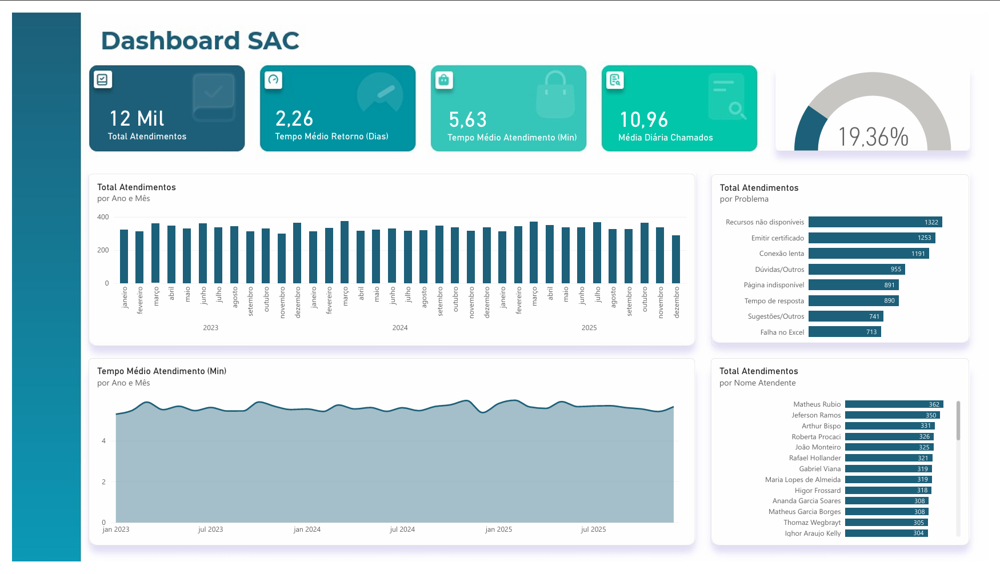

# 📊 Dashboard de Atendimento ao Cliente (SAC) - Power BI


## 📌 Visão Geral do Projeto
Este projeto consiste no desenvolvimento de um **Dashboard de SAC (Serviço de Atendimento ao Consumidor)** no Power BI, criado com o objetivo de analisar a eficiência operacional da equipa de suporte, monitorizar o volume de ocorrências e identificar os principais gargalos no atendimento ao cliente.

---

## 🖼️ Visualização do Dashboard

<!-- Substitua o caminho da imagem abaixo se tiver criado uma pasta images, ou remova se preferir -->


---

## 🎯 Principais Indicadores (KPIs)
O painel centraliza as seguintes métricas de desempenho da operação:
* **Total de Atendimentos:** Volume global de chamados registados no período.
* **Tempo Médio de Retorno:** Média de dias para a primeira resposta ao cliente.
* **Tempo Médio de Atendimento (TMA):** Duração média do chamado em minutos.
* **Média Diária de Chamados:** Volume médio de incidentes por dia.
* **Taxa de Resolução:** Percentagem de eficiência na conclusão dos chamados.

---

## 🛠️ Arquitetura e Modelagem de Dados

### 1. Tratamento de Dados (Power Query)
Os dados foram limpos e estruturados no Power Query, garantindo a integridade das tipagens e a correta relação entre factos e dimensões:
* **Tabela Fato (`fOcorrencias`):** Registo individual de cada atendimento.
* **Tabelas Dimensão:** 
  * `dProblema`: Categoria e descrição dos incidentes.
  * `dSuporte`: Informações sobre os atendentes da equipa.
  * `dUsuario`: Perfis dos clientes registados.

### 2. Modelo Relacional (Star Schema)
A modelagem foi estruturada no esquema em estrela (*Star Schema*), ligando a tabela facto `fOcorrencias` às dimensões `dProblema`, `dSuporte` e `dUsuario` por chaves de relacionamento, garantindo maior eficiência nos filtros dinâmicos e nas medidas em DAX.

---

## 📈 Análises Incluídas
* **Evolução Temporal:** Análise do volume de chamados e do tempo médio de atendimento ao longo dos anos.
* **Principais Motivos de Suporte:** Identificação dos problemas com maior recorrência por parte dos clientes.
* **Desempenho por Atendente:** Ranking de volume de chamados resolvidos por cada membro da equipa.

---

## 📂 Estrutura do Repositório
```text
├── img/               # Screenshots do dashboard para a documentação
├── Relatorio SAC.pbix # Ficheiro original do Power BI
└── README.md          # Documentação do projeto
